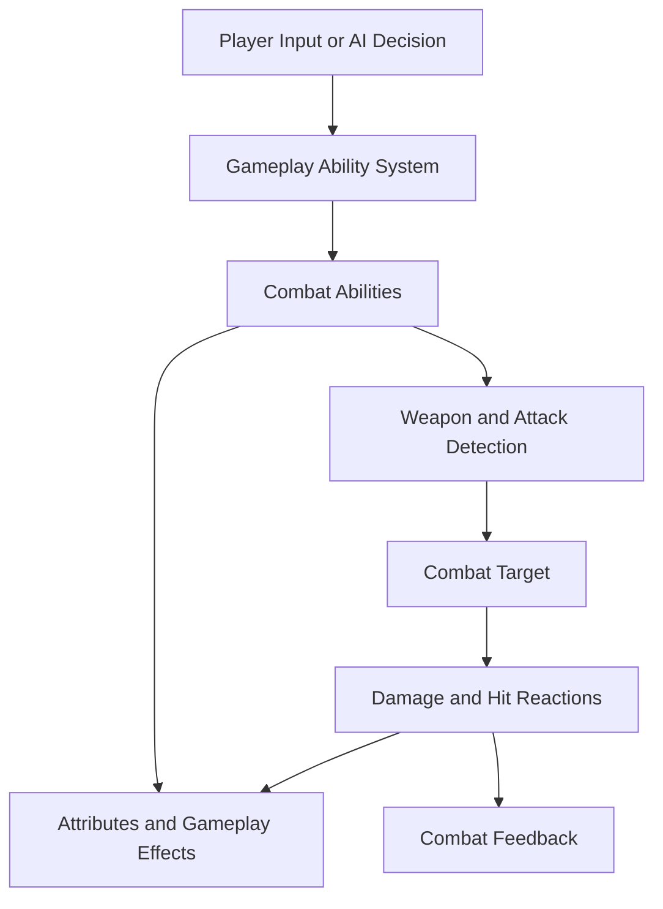
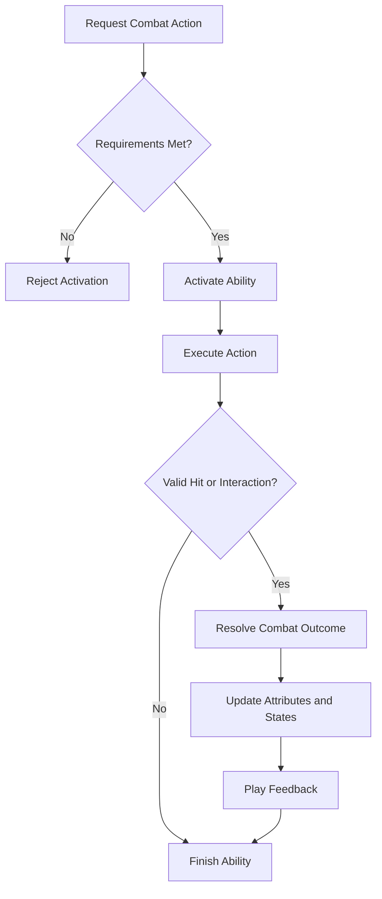

# ELDEN RING-INSPIRED COMBAT SYSTEM

### Modular Third-Person Action Combat | Unreal Engine 5 | Gameplay Ability System

---

## Project Overview

The Elden Ring-Inspired Combat System is a third-person action combat project focused on developing responsive melee mechanics and a modular gameplay architecture.

Built with Unreal Engine 5.7.4 and C++, the project explores Unreal Engine's Gameplay Ability System (GAS) as a foundation for organizing combat abilities, attributes, gameplay effects, and character states.

The combat design emphasizes deliberate attacks, defensive timing, stamina management, and enemy reactions. These mechanics work together to encourage strategic decision-making during combat encounters.

A major technical objective is to develop a shared combat framework for player-controlled characters and AI enemies, reducing duplicated logic while allowing different characters to use distinct abilities and behaviors.

> **Core design principle:** Every offensive and defensive action should have a purpose, a cost, and a consequence.

---

## Table of Contents

- [Project Overview](#project-overview)
- [Project Information](#project-information)
- [Design Pillars](#design-pillars)
- [Combat Features](#combat-features)
- [Gameplay Ability System](#gameplay-ability-system)
- [Combat Architecture](#combat-architecture)
- [Player and AI Integration](#player-and-ai-integration)
- [Stamina and Resource Management](#stamina-and-resource-management)
- [Target Lock and Camera](#target-lock-and-camera)
- [Weapon System](#weapon-system)
- [Combat Flow](#combat-flow)
- [Technical Design Principles](#technical-design-principles)
- [Development Roadmap](#development-roadmap)
- [Technical Skills](#technical-skills)
- [About the Developer](#about-the-developer)

---

## Project Information

| Category | Details |
|---|---|
| Engine | Unreal Engine 5.7.4 |
| Language | C++ |
| Combat Framework | Gameplay Ability System |
| Perspective | Third Person |
| Genre | Action Combat |
| Primary Focus | Gameplay Programming |
| Status | In Development |

---

## Design Pillars

### Deliberate Combat

Combat emphasizes timing, positioning, and selecting appropriate actions. Attacks and defensive maneuvers are designed to have distinct purposes and consequences.

### Resource Management

Stamina connects offensive and defensive decisions. Players must balance immediate actions against the need to preserve resources for future encounters.

### Timing and Precision

Parrying and other defensive mechanics emphasize recognizing incoming attacks and responding within appropriate timing windows.

### Shared Combat Rules

Player-controlled characters and AI enemies are designed to use common combat rules where appropriate, keeping damage, defensive interactions, and resource management consistent.

### Modular Architecture

Combat functionality is organized into individual systems to support additional abilities, weapons, and enemy behaviors without unnecessary duplication.

---

## Combat Features

### Offensive Combat

The intended attack framework includes multiple attack types with distinct purposes.

- **Light Attacks:** Faster attacks for maintaining offensive pressure.
- **Heavy Attacks:** More committed attacks designed for greater impact.
- **Special Attacks:** Three planned variations that expand combat options.
- **Attack States:** Structured execution and transition between combat actions.
- **Damage Processing:** A consistent approach to resolving offensive interactions.

### Blocking

Blocking provides a defensive option against incoming attacks. The system is designed to account for defensive state, stamina expenditure, and the outcome of an incoming hit.

### Parrying

Parrying introduces a timing-based defensive mechanic. Successful timing can create opportunities to counterattack, while unsuccessful attempts can leave the player vulnerable.

### Stance Breaking

Stance breaking rewards effective combat interactions by creating opportunities to punish an opponent whose defense has been compromised.

### Dodging

Dodging provides evasive movement for avoiding incoming attacks. Its intended design connects movement, timing, and stamina consumption.

### Combat Feedback

Combat feedback communicates the outcome of attacks and defensive interactions through animation, gameplay state changes, and appropriate visual or audio effects.

---

## Gameplay Ability System (GAS)

The Gameplay Ability System is a central part of the project's technical direction.

GAS provides functionality for organizing abilities, attributes, gameplay effects, and gameplay tags into a reusable gameplay framework.

### Gameplay Abilities

Individual combat actions can be represented as abilities, keeping action-specific logic separate from shared combat rules.

Potential ability categories include:

- Offensive attacks.
- Blocking and parrying.
- Dodging.
- Special attacks.
- Hit reactions and stagger responses.
- Death and character-state transitions.

### Attribute Management

Attributes represent values that influence combat behavior.

Potential attributes include:

- Health.
- Stamina.
- Attack power.
- Defensive properties.
- Stance-related values.

### Gameplay Effects

Gameplay Effects provide a structured way to modify attributes and apply temporary gameplay changes.

Examples include:

- Applying damage.
- Consuming stamina.
- Restoring resources.
- Applying temporary status effects.
- Modifying combat attributes.

### Gameplay Tags

Gameplay Tags identify combat states and categorize abilities or interactions.

Tags can be used to describe states such as attacking, blocking, stunned, or dead, supporting ability requirements and restrictions between incompatible actions.

---

## Combat Architecture

The architecture separates shared combat functionality from individual abilities and character-specific behavior.

### System Relationship

### System Responsibilities

| System | Responsibility |
|---|---|
| Ability System | Manages ability activation and related gameplay functionality |
| Combat Abilities | Defines individual offensive and defensive actions |
| Attribute System | Represents combat resources and character statistics |
| Gameplay Effects | Applies attribute changes and temporary gameplay modifications |
| Weapon System | Defines weapon behavior and participates in attack detection |
| Targeting System | Identifies and maintains a combat target |
| AI System | Selects actions based on enemy state and combat conditions |
| Animation Integration | Connects combat actions with animation and transitions |

---

## Player and AI Integration

The project aims to make the combat framework reusable across player-controlled characters and AI opponents.

### Player Combat

The player-facing layer translates input into combat actions.

1. The player provides an input.
2. The corresponding ability is requested.
3. Ability requirements are evaluated.
4. The combat action executes.
5. Relevant attributes and states are updated.
6. The result is communicated through gameplay feedback.

### AI Combat

AI decision-making selects actions based on combat conditions, enemy behavior, and available opportunities.

The AI can use shared combat abilities while maintaining its own decision-making logic. This separates the choice of an action from the implementation of the action itself.

### Benefits of Shared Combat Logic

- Reduces duplicated gameplay code.
- Maintains consistent combat rules.
- Simplifies the expansion of enemy abilities.
- Allows shared mechanics to benefit multiple character types.
- Separates AI decision-making from combat execution.

---

## Stamina and Resource Management

Stamina connects individual combat actions into a broader resource-management system.

### Resource Consumption

| Action | Intended Resource Behavior |
|---|---|
| Light Attack | Consumes stamina |
| Heavy Attack | Uses a separately configured stamina cost |
| Special Attack | Uses an ability-specific cost |
| Blocking | Accounts for defensive stamina expenditure |
| Dodging | Consumes stamina for evasive movement |
| Recovery | Restores stamina according to gameplay rules |

### Resource Validation

Before an ability activates, the system should evaluate whether its requirements have been met.

Resource validation helps prevent actions from executing when the character lacks sufficient stamina.

### Recovery and Combat Pacing

Stamina recovery influences the rhythm of combat, encouraging players to balance offense, defense, and recovery.

---

## Target Lock and Camera

Targeting and camera behavior contribute to readable third-person combat.

### Target Lock

Target lock allows the player to focus on a selected enemy and maintain awareness during close-range encounters.

Relevant functionality includes target selection, target validity, movement orientation, and target switching.

### Third-Person Camera

The camera supports free movement and target-focused combat.

Free camera control supports general exploration, while target-focused behavior helps maintain a clear view of the opponent.

The targeting and camera systems are designed to work together while maintaining separate responsibilities.

---

## Weapon System

The weapon system is designed to connect weapon characteristics with combat behavior.

Potential weapon properties include:

- Attack damage.
- Attack timing and animation.
- Stamina costs.
- Attack detection parameters.
- Movement characteristics.
- Special attack availability.

A configurable approach allows weapon properties to be adjusted independently of shared combat logic, supporting future weapon types and combat variations.

---

## Combat Flow

The following diagram illustrates the intended relationship between ability activation and combat resolution.

---

## Technical Design Principles

### Reusable Systems

Shared functionality reduces duplication across player and AI implementations.

### Clear Ownership

Each system has a defined responsibility for managing its own state and behavior.

### Configurable Gameplay

Combat parameters can be configured through appropriate Unreal Engine data and asset systems.

### Maintainable Ability Logic

Abilities remain focused on individual actions while relying on shared systems for common combat rules.

### Incremental Validation

Combat mechanics are tested individually and in combination to identify edge cases and improve reliability.

---

## Development Roadmap

- [ ] Refine the Gameplay Ability System setup.
- [ ] Develop offensive combat abilities.
- [ ] Implement stamina consumption and recovery.
- [ ] Develop blocking and parrying interactions.
- [ ] Integrate attack detection and damage processing.
- [ ] Develop stance-break behavior.
- [ ] Integrate weapon-specific combat configuration.
- [ ] Develop target lock and camera behavior.
- [ ] Connect AI decisions to shared combat abilities.
- [ ] Refine combat feedback and animation integration.

---

## Technical Skills

- Unreal Engine 5.
- C++ gameplay programming.
- Gameplay Ability System.
- Gameplay Attributes and Effects.
- Gameplay Tags.
- Object-oriented programming.
- Modular combat architecture.
- Player and AI system integration.
- Third-person gameplay systems.
- Debugging and technical documentation.

---

## About the Developer

**Brandin Stanfield — Gameplay Programmer**

My focus is on developing gameplay systems using Unreal Engine and C++, with an emphasis on reusable architecture, combat mechanics, and understanding how complex gameplay systems interact.

This project explores the technical foundations of action combat while developing practical experience with the Gameplay Ability System and modular gameplay programming.

### Links

- **GitHub:** [malicehightopp1](https://github.com/malicehightopp1)
- **Project Repository:** [GASCombatSystem](https://github.com/malicehightopp1/GASCombatSystem)
- **Email:** [Brandin.Stanfield@gmail.com](mailto:Brandin.Stanfield@gmail.com)
