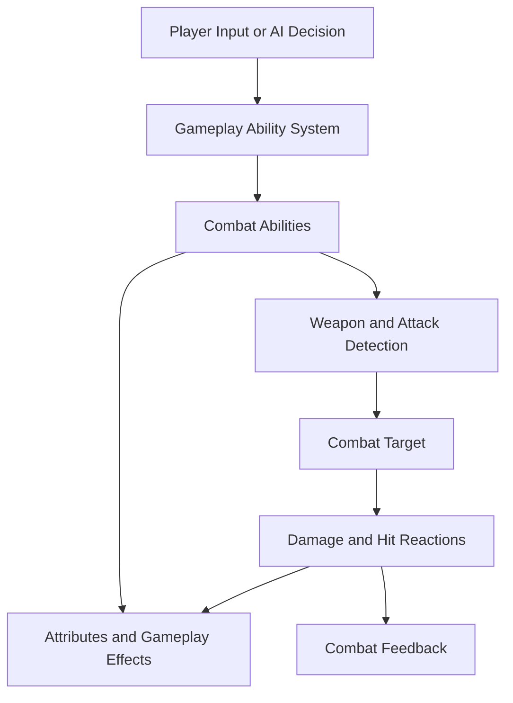
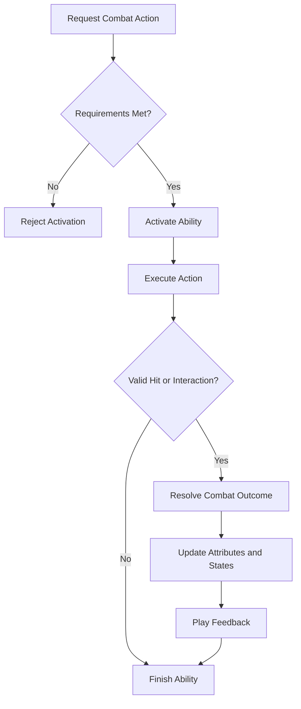

# ELDEN RING-INSPIRED COMBAT SYSTEM

### Modular Third-Person Action Combat | Unreal Engine 5 | Gameplay Ability System

---

## Project Overview

The Elden Ring-Inspired Combat System is a third-person action combat project focused on exploring the architecture and gameplay mechanics behind deliberate, timing-based melee combat.

Developed with Unreal Engine 5.7.4 and C++, the project uses Unreal Engine's Gameplay Ability System (GAS) as the foundation for an extensible combat framework.

The goal is to build a system in which attacking, defending, dodging, managing stamina, and reacting to enemy behavior are connected through clear gameplay rules rather than implemented as unrelated mechanics.

A major technical objective is to develop an architecture that can support both player-controlled characters and AI opponents. Shared combat rules should be reusable, while character-specific behavior remains independently configurable.

Inspired by the combat design of *Elden Ring*, the project explores how timing, resource management, defensive decisions, and enemy reactions can work together to create meaningful combat encounters.

> **Core design principle:** Every offensive and defensive action should have a purpose, a cost, and a consequence.

---

## Table of Contents

- [Project Overview](#project-overview)
- [Project Information](#project-information)
- [Design Pillars](#design-pillars)
- [Combat Features](#combat-features)
- [Gameplay Ability System](#gameplay-ability-system)
- [Combat Architecture](#combat-architecture)
- [Player and AI Integration](#player-and-ai-integration)
- [Stamina and Resource Management](#stamina-and-resource-management)
- [Target Lock and Camera](#target-lock-and-camera)
- [Weapon System](#weapon-system)
- [Combat Flow](#combat-flow)
- [Technical Design Principles](#technical-design-principles)
- [Development Roadmap](#development-roadmap)
- [Screenshots and Demonstrations](#screenshots-and-demonstrations)
- [Technical Skills](#technical-skills)
- [About the Developer](#about-the-developer)

---

## Project Information

| Category | Details |
|---|---|
| Engine | Unreal Engine 5.7.4 |
| Language | C++ |
| Combat Framework | Gameplay Ability System |
| Perspective | Third Person |
| Genre | Action Combat |
| Primary Focus | Gameplay Programming |
| Development Status | In Progress |

---

## Design Pillars

### 1. Deliberate Combat

Combat should reward players for understanding enemy behavior and choosing the right moment to attack or defend.

Attacks, dodges, blocks, and parries should have distinct purposes. Each action should create a meaningful decision rather than allowing the player to rely on one repeated response.

### 2. Resource Management

Stamina is intended to influence how aggressively the player can fight.

Attacking and defending should be balanced against the need to preserve resources for future actions. Spending too much stamina should create vulnerability and encourage more deliberate decisions.

### 3. Timing and Precision

Parrying and other defensive mechanics are designed around recognizing an incoming attack and responding within a defined timing window.

Successful defensive interactions should provide an advantage, while missed timing or poor resource management should carry consequences.

### 4. Shared Player and AI Combat Rules

The player and AI should operate within a consistent combat framework.

Both should interact with common combat rules for damage, defensive states, stamina costs, and combat outcomes where appropriate. This helps reduce duplicated logic and makes it easier to expand enemy behavior.

### 5. Modular Gameplay Architecture

Individual combat mechanics should be organized so that new abilities, weapons, and enemy behaviors can be introduced without rewriting the entire combat system.

The Gameplay Ability System provides the foundation for exploring this approach.

---

## Combat Features

The following sections describe the intended combat design. Features should be marked as implemented in the repository only after their functionality has been verified.

### Offensive Combat

The attack system is intended to support multiple attack types with different purposes and resource costs.

- **Light Attacks:** Faster offensive actions for maintaining pressure.
- **Heavy Attacks:** Slower, more committed attacks intended to deliver greater impact.
- **Special Attacks:** Three planned special attack variations that can expand combat options.
- **Attack States:** A structured approach to managing attack execution and transitions.
- **Damage Processing:** A consistent path for applying and resolving combat damage.

The objective is to make attack behavior extensible so that new actions can be introduced without duplicating the underlying combat rules.

### Blocking

Blocking provides a defensive option for responding to incoming attacks.

The intended system should account for defensive state, stamina expenditure, and the outcome of an incoming hit.

Separating blocking logic from individual attack implementations makes it easier to apply consistent defensive rules across different enemies and weapons.

### Parrying

Parrying introduces a timing-based defensive mechanic.

The intended behavior is to evaluate whether a defensive action occurs within an appropriate window relative to an incoming attack.

A successful parry can create an opportunity to punish an opponent, while a failed attempt may leave the player vulnerable.

### Stance Breaking

Stance breaking is intended to reward effective offensive and defensive interactions.

Repeated pressure or successful combat actions can contribute toward creating an opening in an opponent's defense. A stance break can then provide an opportunity for a stronger follow-up attack.

This mechanic encourages players to understand enemy defenses rather than relying exclusively on damage output.

### Dodging

Dodging provides an evasive response to incoming attacks.

The system is intended to connect movement, timing, and stamina consumption so that dodging becomes a meaningful combat decision.

### Combat Feedback

Combat should communicate its outcomes clearly through animation, state changes, and appropriate visual or audio feedback.

Future documentation should include the specific hit reactions, effects, and gameplay cues that are implemented.

---

## Gameplay Ability System (GAS)

The Gameplay Ability System is a central technical focus of this project.

GAS provides a framework for managing gameplay abilities, attributes, gameplay effects, and gameplay tags. These systems can help organize combat behavior into reusable units.

### Gameplay Abilities

Combat actions can be represented as individual abilities rather than placing every action inside a single character class.

Potential ability categories include:

- Offensive attacks.
- Blocking and parrying.
- Dodging.
- Special attacks.
- Hit reactions and stagger responses.
- Death and other character-state transitions.

Each ability can own the behavior specific to that action while interacting with shared combat systems.

### Attribute Management

Attributes provide a structured way to represent values that influence combat.

Potential attributes include:

- Health.
- Stamina.
- Attack power.
- Defensive properties.
- Stance or poise-related values.

The exact attribute set and implementation should be documented as the system is developed.

### Gameplay Effects

Gameplay Effects can represent changes to attributes or temporary gameplay conditions.

Examples of possible uses include:

- Applying damage.
- Consuming stamina.
- Restoring resources.
- Applying temporary status changes.
- Modifying combat attributes.

Centralizing these operations through appropriate GAS systems can make combat interactions easier to extend and balance.

### Gameplay Tags

Gameplay Tags can identify gameplay states and categorize abilities or interactions.

For example, tags can distinguish attacking, blocking, stunned, or dead states when those states are implemented.

Tags can also support ability requirements and restrictions, helping prevent incompatible actions from executing simultaneously.

---

## Combat Architecture

The architectural goal is to separate reusable combat rules from the behavior of individual characters and abilities.

### Conceptual System Diagram

This diagram illustrates a proposed logical flow, not a verified class diagram of the current implementation.

### Responsibility Separation

| System | Intended Responsibility |
|---|---|
| Ability System | Manage ability activation and related gameplay functionality |
| Combat Abilities | Define individual offensive and defensive actions |
| Attribute System | Represent combat resources and relevant character statistics |
| Gameplay Effects | Apply attribute changes and temporary gameplay modifications |
| Weapon System | Define weapon behavior and participate in attack detection |
| Targeting System | Identify and maintain a combat target |
| AI System | Select actions based on enemy state and combat conditions |
| Animation Integration | Communicate combat actions and transitions through animation |

The purpose of this separation is to keep the architecture understandable as the number of combat mechanics increases.

---

## Player and AI Integration

A major development goal is to make the combat framework useful for both player-controlled characters and AI enemies.

### Player Combat

The player-facing layer is responsible for translating input into combat decisions.

The intended flow is:

1. The player provides an input.
2. The appropriate ability is requested.
3. The ability checks its activation requirements.
4. Relevant combat behavior executes.
5. Attributes and gameplay states are updated.
6. The result is communicated through animation and feedback.

### AI Combat

AI should use the same underlying combat rules wherever possible.

Instead of implementing a separate damage or stamina system for enemies, AI behavior should select actions that interact with the shared combat framework.

AI decision-making can be responsible for selecting when to attack, defend, reposition, or recover, while the combat abilities handle the action itself.

### Benefits of Shared Combat Logic

- Reduces duplicated gameplay code.
- Keeps combat rules consistent.
- Makes enemy abilities easier to expand.
- Allows combat changes to benefit multiple character types.
- Creates a clearer boundary between decision-making and action execution.

The specific AI controller, behavior tree, or other decision-making implementation should be documented once finalized.

---

## Stamina and Resource Management

Stamina is intended to connect individual combat actions into a larger decision-making system.

### Resource Consumption

Different actions can require different stamina costs.

| Action | Intended Resource Behavior |
|---|---|
| Light Attack | Consume stamina |
| Heavy Attack | Consume a larger or separately configured cost |
| Special Attack | Use an ability-specific cost |
| Blocking | Account for the cost of defending |
| Dodging | Consume stamina for evasive movement |
| Recovery | Restore stamina according to the implemented rules |

These are design intentions, not confirmed balance values.

### Resource Validation

Before an ability activates, the system should determine whether its requirements have been satisfied.

A resource validation process can help prevent an action from starting when the character does not have enough stamina.

### Recovery and Combat Pacing

Stamina recovery should influence the rhythm of combat.

Players should be encouraged to alternate between offense, defense, and recovery instead of continuously spending resources without consequence.

---

## Target Lock and Camera

Targeting and camera behavior are important to maintaining readable third-person combat.

### Target Lock

The intended target-lock system should allow the player to focus on a selected enemy.

Target-focused movement can make it easier to maintain awareness of the opponent during close-range encounters.

Relevant implementation considerations include:

- Selecting a valid target.
- Maintaining target focus.
- Handling invalid or defeated targets.
- Updating movement orientation.
- Supporting target changes when necessary.

### Third-Person Camera

The camera system is intended to support both free camera control and target-focused combat.

Free camera behavior provides general exploration and orientation, while target-focused behavior helps maintain a clear view of the opponent.

The camera and targeting systems should work together without unnecessarily coupling camera logic to individual combat abilities.

---

## Weapon System

Weapons should influence combat behavior through configurable properties rather than requiring an entirely separate combat implementation for each weapon.

Potential weapon-specific properties include:

- Attack damage.
- Attack timing and animation.
- Stamina costs.
- Attack detection parameters.
- Movement or handling characteristics.
- Special attack availability.

A data-driven design can allow weapon characteristics to be adjusted independently of shared combat logic.

The final implementation should document how weapons are represented, how their properties are configured, and how those properties interact with the Gameplay Ability System.

---

## Combat Flow

The following sequence illustrates the intended relationship between a combat action and its result.

This is a conceptual workflow. Actual execution order will depend on the implementation of each ability and the relevant gameplay systems.

---

## Technical Design Principles

### Reusable Systems

Common functionality should be shared where appropriate, avoiding unnecessary duplication between player and AI implementations.

### Clear Ownership

Each system should have a defined responsibility for managing its own state and behavior.

### Configurable Gameplay

Where appropriate, combat parameters should be exposed through Unreal Engine's data and asset systems to make iteration easier.

### Maintainable Ability Logic

Abilities should remain focused on their individual actions while relying on shared systems for common rules.

### Incremental Validation

Combat features should be tested individually and in combination to identify edge cases before additional complexity is introduced.

---

## Development Roadmap

- [ ] Document the current Gameplay Ability System setup.
- [ ] Document the project's actual C++ classes and responsibilities.
- [ ] Implement and validate core offensive abilities.
- [ ] Develop stamina costs and recovery behavior.
- [ ] Develop blocking and parrying interactions.
- [ ] Integrate attack detection and damage processing.
- [ ] Develop stance-break behavior.
- [ ] Integrate weapon-specific combat configuration.
- [ ] Develop target lock and camera behavior.
- [ ] Connect AI decisions to shared combat abilities.
- [ ] Add screenshots, gameplay clips, and implementation diagrams.
- [ ] Document technical challenges and completed solutions.

*Update each item as its implementation is completed and tested.*

---

## Screenshots and Demonstrations

Visual demonstrations should show the combat mechanics working in the actual project.

Recommended captures:

- Third-person gameplay.
- Light and heavy attack execution.
- Blocking and parrying interactions.
- Stamina behavior during combat.
- Target-lock and camera behavior.
- Enemy combat behavior.
- Unreal Engine views showing the relevant C++ and Blueprint integration.

Add actual screenshots or short gameplay clips here as they become available.

---

## Technical Skills

This project focuses on developing practical experience with:

- Unreal Engine 5.
- C++ gameplay programming.
- Gameplay Ability System.
- Gameplay Attributes and Effects.
- Gameplay Tags.
- Object-oriented programming.
- Modular combat architecture.
- Player and AI system integration.
- Third-person gameplay systems.
- Debugging and technical documentation.

---

## About the Developer

**Brandin Stanfield — Gameplay Programmer**

I am focused on developing gameplay systems using Unreal Engine and C++, with an emphasis on reusable architecture, combat mechanics, and understanding how complex gameplay systems work together.

This project explores the technical foundations of action combat while providing an opportunity to build, test, and refine gameplay functionality through practical implementation.

### Links

- **GitHub:** [malicehightopp1](https://github.com/malicehightopp1)
- **Project Repository:** [GASCombatSystem](https://github.com/malicehightopp1/GASCombatSystem)
- **Email:** Brandin.Stanfield@gmail.com

---

*This README is intended to evolve alongside the project, documenting implemented mechanics, technical architecture, and lessons learned throughout development.*
